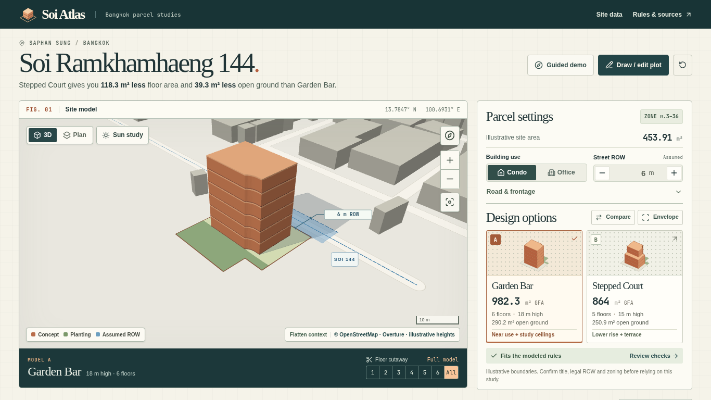
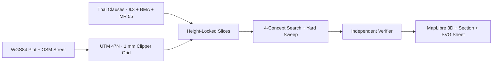

# Soi Atlas

### See what fits a Bangkok plot before you pay the architect.

_Deterministic low-rise parcel massing under Bangkok's ย.3-36 building rules._

[Run locally](#run-it) · [Rulebook](planning/RULEBOOK.md) · [Worked fixtures](planning/ACCEPTANCE.md) · [Benchmarks & notes](docs/DELIVERY.md)



## Why I approached it this way

I am a YIMBY who has been into construction codes and urban policy for a long time (one of my earlier systems, [`bis_rag`](https://github.com/isHeSatoshi/bis_rag), mapped engineering queries to Indian BIS construction standards). When you read enough municipal building codes, you see how NIMBYism gets baked directly into the math: **a city can advertise a generous 2.5× Floor Area Ratio (FAR) on paper, and then use setback and road-width rules to quietly kill half the housing before FAR ever binds.**

On a 454 m² notched plot on Soi Ramkhamhaeng 144 (`ย.3-36`), multiplying by the 2.5× base FAR says you can build **1,135 m²**. In reality, four rules eat the building from the outside in:
- **Public ROW use caps:** condos cap at `1,000 m²` under `30 m` streets; standalone offices jump from `300 m²` to `500 m²` at `16 m` ROW.
- **Height-stepped setbacks:** windowed walls step back `2 m` up to `9 m` height and `3 m` above `9 m` (or from Floor 3 up).
- **The 2:1 road sky plane:** height cannot exceed `2 × (W + d)` from the opposite side of the road.
- **Three open-space denominators:** uncovered yard must satisfy BMA's land share (`30%` condo / `10%` office), the zone's `12.5%` of GFA, and MR 55's share of the largest floor, with `50%` kept as one contiguous planted patch.

I pulled and translated the Thai Royal Gazette, BMA, and MR 55 texts, encoded each clause as a spatial or area constraint, and built a deterministic polygon solver where **the generator is never allowed to grade itself**.

## Traps I caught by reading the Thai texts and data first

1. **A bad English translation in BMA §50(1):** The widely cited IIBH English PDF translates §50(1) as applying to roads *"not less than 10 m"*, colliding with §50(2) (`10–20 m`). The Thai text (`ข้อ ๕๐(๑)`) says `ความกว้างน้อยกว่า 10 เมตร` (**less than** 10 m) and also restores a `1 m` minimum clearance omitted from §55.
2. **OSR is a share of GFA, not land:** In Bangkok's 2556 plan (`ที่ว่างต่อพื้นที่อาคารรวม`), `12.5% OSR` is `12.5%` of built floor area (`31.25%` of the plot at 2.5× FAR). On a 400 m² condo lot, BMA's `30%` land rule governs at 800 m² GFA (`120 m² > 100 m²`), then OSR takes over at 1,000 m² GFA (`125 m² > 120 m²`).
3. **Upper floors change Floor 1's legal setback:** Adding a 4th floor pushes total height over `9 m`, moving Floor 1's legal side wall inward from `2 m` to `3 m`. The solver locks total height *before* buffering private parcel edges.
4. **OSM had 94 roads on our block, but only 2 buildings:** I kept the 94 OSM road ways and merged **559 real building footprints** from **Overture Maps (`2026-11-18.0`)** so the scene renders real neighborhood context offline.

## How the solver works



```text
  Opposite ROW         Near ROW / Plot Edge                 Rear Boundary
       |                      |        2:1 Sky Plane              |
       |                      |       z <= 2 * (W + d)            |
       |                      |           /   +---------------+   |  <- Floor 6 (18 m)
       |                      |          /    |   Upper Bar   |   |
       |                      |         /     +---------------+---|  <- Terrace step
       |                      |        /      |   Lower Base      |
=======+======================+=======+=======+===================+===  Ground (z = 0)
       |<------ Road W ------>|<-- d ->|<---- Open Yard O = A - C --->|
```

## What the default site shows

On the default **453.91 m² notched plot** on Soi Ramkhamhaeng 144 (`6 m` ROW, Condo), four concepts pass all 16 checks:

| Concept | Gross floor area | Height | Open ground | Planted yard | Governing factor |
|---|---:|---:|---:|---:|---|
| **A · Garden Bar** | **982.3 m²** | 6 floors · 18 m | 290.2 m² | 145.1 m² | Near 1,000 m² use + study cap |
| **B · Stepped Court** | **864.0 m²** | 5 floors · 15 m | 250.9 m² | 125.5 m² | Lower rise + terrace step |
| **C · Street Pavilion** | **552.7 m²** | 3 floors · 9 m | 269.7 m² | 134.9 m² | 3-floor low-rise target |
| **D · Sky Lantern** | **547.8 m²** | 6 floors · 18 m | 356.1 m² | 178.1 m² | Slim plate + roof step |

Look at **Garden Bar** versus **Stepped Court**. The classic NIMBY demand at any planning hearing is *"chop a floor off and add a step-back so it feels less bulky."* When you actually run the geometry, forcing the building down from 6 floors to 5 with a terrace makes the lower plates spread wider across the lot, **wiping out 118.3 m² of housing AND 39.3 m² of green yard at the same time**. Everyone gets fewer homes and less grass, which is peak neighborhood preservation.

## Run it

Live demo: [soi-atlas-bangkok.pages.dev](https://soi-atlas-bangkok.pages.dev/).

```sh
npm ci && npm run build
npm run preview -- --host 127.0.0.1 --port 4173 --strictPort
```

Open [http://127.0.0.1:4173/](http://127.0.0.1:4173/). Tests: `npm test` (17 unit oracle tests) · `CHROMIUM_BIN=/usr/bin/chromium npm run test:browser` (11 Chromium E2E tests, `34.4 ms` UI / `51.6 ms` WebGL p95 drag latency).

Roads: 94 ways [© OpenStreetMap contributors](https://www.openstreetmap.org/copyright) ([ODbL 1.0](https://opendatacommons.org/licenses/odbl/1-0/)). Buildings: 559 [Overture Maps](https://docs.overturemaps.org/attribution/#buildings) footprints (`2026-11-18.0`).

## Deploy

GitHub Actions tests and builds `main`, then uploads `dist/` to the existing Cloudflare Pages Direct Upload project. Set `CLOUDFLARE_ACCOUNT_ID` and `CLOUDFLARE_API_TOKEN` in GitHub Actions repository secrets. The token needs **Account → Cloudflare Pages → Edit** on the hosting account. Run **Deploy Cloudflare Pages** manually after setting the secrets, or push to `main`.
